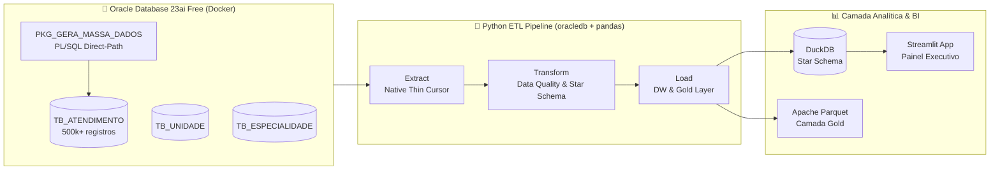

# 🏥 Healthcare Oracle ETL Pipeline & Operational BI

[](https://www.oracle.com/database/free/)
[](https://www.python.org/)
[](https://duckdb.org/)
[](https://streamlit.io/)
[](https://www.docker.com/)

Pipeline completo de **Engenharia de Dados e Inteligência Operacional Hospitalar** desenvolvido por **[Luccas Silva (`@LSDataScience`)](https://github.com/LSDataScience)**, unindo mais de 10 anos de experiência prática em sistemas críticos de saúde (MV Soul / MV PEP, PACS, Faturamento SUS e Controladoria) com arquitetura moderna de dados.

> **Conformidade LGPD:** Todos os dados utilizados neste projeto são **100% sintéticos**, gerados proceduralmente via PL/SQL com hashes SHA-256 anonimizados (`STANDARD_HASH`). Nenhum dado real de pacientes ou instituições é utilizado.

---

## 🏗️ Arquitetura End-to-End



---

## ⚡ Boas Práticas & Destaques Técnicos

* **Modelagem Transacional & Carga em Lote (Oracle PL/SQL):** Package `PKG_GERA_MASSA_DADOS` utilizando `INSERT /*+ APPEND */`, `CONNECT BY LEVEL` e coleta de estatísticas do otimizador (`DBMS_STATS.GATHER_TABLE_STATS`) para gerar 500.000+ atendimentos em segundos.
* **Query Tuning & Plano de Execução (`sql/tuning/01_analise_performance.sql`):** Comparação via `EXPLAIN PLAN` e `DBMS_XPLAN.DISPLAY` eliminando `TABLE ACCESS FULL` causado por funções em colunas indexadas (`TO_CHAR`), aplicando predicados *sargables*, **CTEs** e **Índice Composto com `INCLUDE`** (`INDEX RANGE SCAN`).
* **Pipeline ETL Modular & Data Quality (`src/`):** Extração nativa via `python-oracledb` em modo *Thin* (sem Instant Client), validação de integridade temporal (`DT_ALTA >= DT_ATENDIMENTO`), cálculo de Tempo Médio de Permanência (ALOS) e persistência dimensional (**Star Schema**) em **DuckDB** e **Apache Parquet**.
* **Painel Executivo Clínico (`app/dashboard.py`):** Interface construída seguindo convenções de *Healthcare BI* com Taxa de Ocupação Operacional, ALOS, Matriz Unidade × Especialidade e Mix SUS/Convênios.

---

## 🚀 Como Executar Localmente

1. **Subir o Banco Oracle 23ai Free:**
   ```bash
   docker compose up -d
   ```

2. **Provisionar o Schema e Gerar os Dados (DBeaver / SQL\*Plus):**
   Conecte-se ao `FREEPDB1` (`localhost:1521/FREEPDB1`) e execute em ordem:
   * `docker/init/01_setup_schema.sql` (como `SYSDBA`)
   * `sql/ddl/01_create_tables.sql` (como `HOSP_LAB`)
   * `sql/plsql/01_pkg_gera_massa_dados.sql` (como `HOSP_LAB`)

3. **Executar o Pipeline ETL e o Dashboard:**
   ```powershell
   python -m venv .venv
   .\.venv\Scripts\Activate.ps1
   pip install -r requirements.txt
   Copy-Item .env.example .env

   python -m src.pipeline
   streamlit run app/dashboard.py
   ```

---

## 👨‍💻 Sobre o Autor

**Luccas Silva** — Analista de Sistemas & Dados  
* +10 anos de experiência em sistemas críticos hospitalares (MV Soul / MV PEP), Oracle SQL/PL/SQL, Python e Business Intelligence.
* Pós-graduando em Engenharia de Dados (UniAmérica Descomplica).
* 🔗 **LinkedIn:** [linkedin.com/in/luccas-silva](https://www.linkedin.com/in/luccas-silva/)
* 💻 **GitHub:** [github.com/LSDataScience](https://github.com/LSDataScience)
